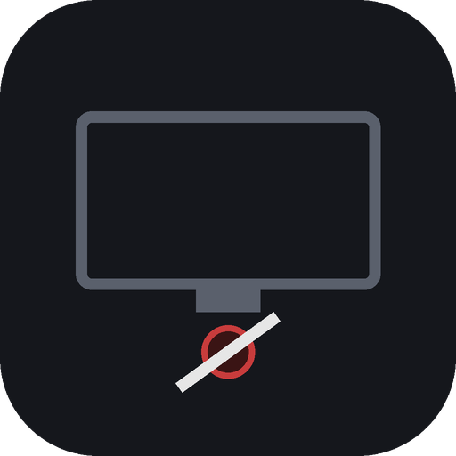
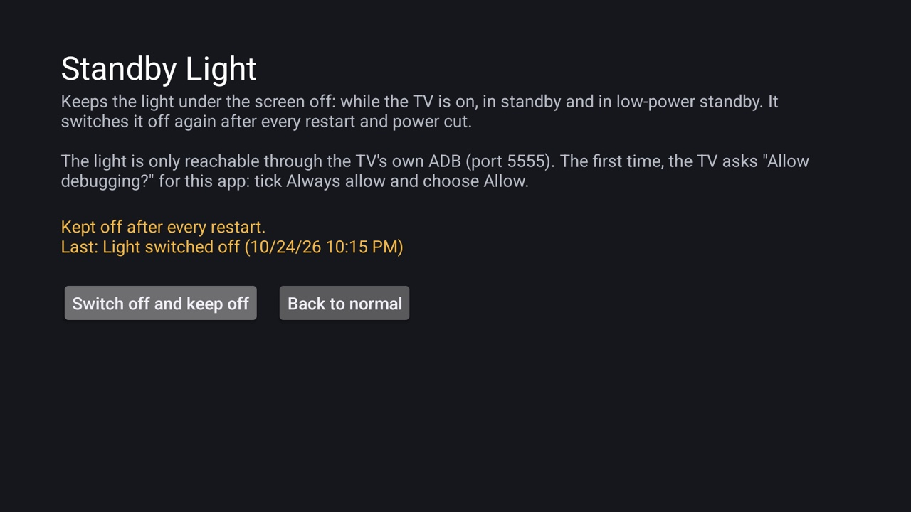

  

  <strong>Keeps the standby light of Realtek-based Android TVs off, after every restart and power cut</strong>

  
  
  
  

<h1>Standby Light</h1>

Some Android TVs keep a bright light under the screen on all night while they're off, and have no setting for it. On TVs built on Realtek's platform the light can be switched off from the ADB shell, but the TV forgets that on every power cut. Standby Light switches it off for you, in every state (on, standby, low-power standby, blinking), and again after every restart.

<h2>Screenshots</h2>

  

<h2>Features</h2>

<ul>
  <li><strong>One button</strong>: <em>Switch off and keep off</em>, and <em>Back to normal</em> to undo it</li>
  <li><strong>Every LED state</strong>: on, panel off, standby, low-power standby and blinking</li>
  <li><strong>Survives restarts</strong>: switches the light off again after boot and after the app is updated</li>
  <li><strong>Shows what happened</strong>: the screen says whether it's kept off and how the last try went</li>
  <li><strong>Small and private</strong>: plain Java, no libraries, about 20 KB; talks only to the TV itself</li>
</ul>

<h2>Requirements</h2>

<ul>
  <li>An Android TV on <strong>Android 11 or newer</strong> with Realtek's LED service. Check with:
<pre>
adb shell service check com.realtek.power.ILedManager/default
</pre>
  It must say <code>found</code>. If it says <code>not found</code>, this app can't switch your TV's light (<code>install.sh</code> checks this for you).</li>
  <li><strong>Network debugging</strong> (ADB over the network, port 5555) switched on, and left on: the app reaches the light through it</li>
</ul>

<h2>Installation and Setup</h2>

<h3>From a release (recommended)</h3>

<ol>
  <li>Download <code>StandbyLight-x.y.z.apk</code> from the <a href="../../releases/latest">latest release</a>.</li>
  <li>Install it, from a computer with <a href="https://developer.android.com/tools/releases/platform-tools">ADB</a>:
<pre>
TV_HOST=&lt;tv ip&gt; APK=StandbyLight-0.1.0.apk ./install.sh
</pre>
  or with any sideloading app on the TV.</li>
  <li>On the TV, press <strong>Switch off and keep off</strong>.</li>
  <li>The TV asks <strong>"Allow USB debugging?"</strong> for the app's key. Tick <strong>Always allow from this computer</strong> and choose <strong>Allow</strong> within a minute. If the screen then says "not allowed", press the button again: the TV now knows the key.</li>
</ol>

<h3>From source</h3>

JDK 17 and Android SDK platform 34 with build-tools 34.0.0: <code>TV_HOST=&lt;tv ip&gt; ./install.sh</code>. To build only: <code>./gradlew assembleRelease</code>; the JVM tests run with <code>./gradlew testReleaseUnitTest</code>. Where macOS blocks the stock <code>adb</code>, set <code>CLEANYOURTV</code> to a clone of <a href="https://github.com/Gathin23/cleanyourtv">Clean Your TV</a> with its tools set up.

<h2>Usage</h2>

<table>
  <tr><th>On the TV</th><th>What it does</th></tr>
  <tr><td><strong>Switch off and keep off</strong></td><td>Switches the light off in every state now, and again after every restart.</td></tr>
  <tr><td><strong>Back to normal</strong></td><td>Puts every state back to normal and stops switching it off after restarts.</td></tr>
  <tr><td><strong>Last:</strong></td><td>How the last try went, and when: "Light switched off", or why it couldn't.</td></tr>
</table>

To remove it: <strong>Back to normal</strong>, then uninstall. Settings → Developer options → <em>Revoke USB debugging authorizations</em> also removes its key.

<h2>How It Works</h2>

<pre>
 boot / app updated ──► job (retries for about 3 minutes, until ADB is up)
                          │
                          ▼
 the app ──► ADB at 127.0.0.1:5555, signed in with its own key
                          │
                          ▼
 service call com.realtek.power.ILedManager/default 1 i32 &lt;state 0-4&gt; i32 0
</pre>

<ul>
  <li>Realtek's LED service lets only the ADB shell change the light, so an ordinary app can't. Standby Light carries a small ADB client of its own (no libraries) and signs in to the TV's own ADB, the way a computer does, with an RSA key made on the TV.</li>
  <li>It sends one fixed command and nothing else. Nothing from outside the app can change that command; see <a href="SECURITY.md">SECURITY.md</a>.</li>
  <li>The TV keeps the setting until the power goes; the app's job puts it back after every boot, but only when you chose <em>keep off</em>.</li>
</ul>

<h2>Known Limitations</h2>

<ul>
  <li><strong>Realtek's AIDL LED service only.</strong> TVs on Realtek's older HIDL service (<code>vendor.realtek.system@1.1::IRtkLEDManager</code>, for example some Android 11 models) refuse it from the shell, and MediaTek TVs hide their LED settings. On those TVs this app can't help.</li>
  <li><strong>Network debugging stays on.</strong> That's how the app reaches the light. Keep port 5555 off the internet.</li>
  <li><strong>A few seconds of light after boot.</strong> The light is on until ADB is up and the job runs.</li>
  <li><strong>The prompt is only on the TV.</strong> Someone has to allow the key once, with the remote.</li>
</ul>

<h2>Tested On</h2>

MOKA R8G (Android 14), 2026-10-24: after the key was allowed, <strong>Switch off and keep off</strong> reported "Light switched off" (all five states answered), and the light stayed off overnight in standby. A boot after a power cut hasn't been checked on this release yet. The ADB client's signature was also checked against the ADB of an Android 11 TV. The JVM tests cover the signature, the public key format, the ADB messages, the command and how its answer is read.

<h2>License</h2>

This project is licensed under the MIT License.

See the [LICENSE](LICENSE) file for details.
Full license text: https://opensource.org/licenses/MIT

<h2>Contributing</h2>

Pull requests are welcome, especially other TVs whose light the ADB shell can reach. Open an issue first; report security issues privately (see <a href="SECURITY.md">SECURITY.md</a>). See <a href="CONTRIBUTING.md">CONTRIBUTING.md</a> and the <a href="CODE_OF_CONDUCT.md">Code of Conduct</a>.

<h2>Related Projects</h2>

<ul>
  <li><a href="https://github.com/Gathin23/cleanyourtv">Clean Your TV</a>: debloat tools and a lean launcher for Android TV</li>
  <li><a href="https://github.com/maxhayim/kids-mode">Kids Mode</a>: a PIN-locked kids' screen for Android TV</li>
  <li><a href="https://github.com/maxhayim/webmote">Webmote</a>: a remote for Android TV in your phone's or computer's browser</li>
</ul>

<h2>Acknowledgments</h2>

The icon and art are Standby Light's own. 
Android™, Android TV™ and Google TV™ are trademarks of Google LLC; Realtek is a trademark of Realtek Semiconductor Corp. They are used here solely to describe compatibility.
All other trademarks are the property of their respective owners.

